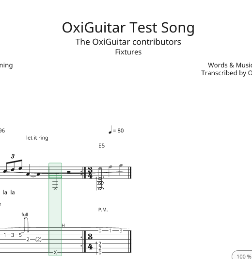

# oxiguitar-wah

The wah-wah plugin for [OxiGuitar](https://github.com/mateusrdp/oxiguitar), a free, open-source guitar tablature and score viewer, editor and player for Windows, macOS and Linux. It writes and plays wah-wah marks, and all of it is the plugin's: OxiGuitar itself has no wah tool, editor or filter.



Hear it: [two bars of chords, the second with open and closed marks](docs/sounds/wah.mp3) (a plucked string of our own through the pedal; `cargo run --example sound -- wah.wav` makes it).

- Plugin file `wah.oxp`, id `oxiguitar.wah`, shown as **Wah-wah**.
- **Two tools on the palette**, under Effects: **Closed Wah-Wah** ("+") and **Open Wah-Wah** ("o"). Each opens the **wah-wah editor** for the caret's beat or the selected beats: the mark (none, open or closed), the filter's **Q** (4 is a Cry Baby's; higher is more nasal) and the pedal across the beat, from heel to toe, as a curve whose points you drag. On a beat without a mark the editor opens on the mark you clicked, so OK adds it. One step for Undo.
- **It follows the score.** An open mark takes the pedal from the heel to the toe over the first half of its beat ("wah"), a closed one back; marks that alternate rock it back and forth; a mark with a curve of its own plays that. On beats without a mark the pedal is off and the track passes untouched.
- **A Cry Baby by default**: Julius O. Smith's digital model of the Dunlop pedal, one resonance swept from 450 Hz (heel down, narrow) to 2.2 kHz (toe down, wide).
- Per track, in the Track tab's section **Wah-wah**:
  - **Play the score's wah-wah marks**, ticked by default: untick it for a track whose marks should stay silent.
  - **Heel**, where the sweep starts (200 to 800 Hz), and **Sweep**, how far the toe takes it (1 to 3.5 octaves); **Cry Baby** sets both back (450 Hz, 2.3 octaves).
  - It works while the song plays.
- On any track: guitars, basses, keys. It runs before the amp (the NAM plugin) and the equalizer, as a pedal in front of an amplifier, unless the Track tab moves it.
- No latency, and nothing allocated while it plays. The pedal comes in and goes out over 10 ms, so nothing clicks.

## Where things are kept

- The open or closed mark is the score's own: Guitar Pro files hold it, and OxiGuitar draws it with or without this plugin.
- A mark's curve and Q are the plugin's data on that beat (`{"q": 6, "points": [[0, 0], [0.5, 100], [1, 50]]}`: time across the beat from 0 to 1, the pedal from 0, heel, to 100, toe). They follow the beat when it is copied or moved. No score format holds them, so OxiGuitar saves them in the `.oxg` file beside the song, with the track's section.

## How it uses OxiGuitar's plugin interface

Everything here is interface 1.8, and a plugin of yours can do the same ([the plugin guide](https://github.com/mateusrdp/oxiguitar/tree/develop/docs/plugins/src)):

| What | How |
| --- | --- |
| The palette's two buttons | `palette` on each tool of `manifest.json`: the section and a symbol of the music font |
| The editor | A tab whose area is `dialog` (`src/editor.rs`), opened by the tools with `Host::open_dialog`; widgets and a canvas, with OxiGuitar's OK and Cancel |
| The caret's beat | `Host::selection` when a tool runs |
| Writing the mark | `Host::score2` and `Host::apply`: the mark is `BeatExt::Wah`, the curve and Q `BeatExt::Plugin` |
| Playing it | An effect with `follows_score`: `Effect::prepare_following` gets every beat the track plays, with its marks and data (`src/curve.rs` makes one curve of them), and `Processor::process_at` the score's time with each block |
| Before the amp | `order: 100` on the effect |

## How it makes its sound

The filter is one second-order resonance with a zero at 0 Hz, as in Julius O. Smith's ["Digital CryBaby"](https://ccrma.stanford.edu/realsimple/faust_strings/Digital_CryBaby_Faust.html) (*Making Virtual Electric Guitars and Associated Effects Using Faust*, CCRMA, Stanford), which fits a measured Cry Baby: with the pedal at `w` from 0 (heel) to 1 (toe), the resonance is at 450 · 2^(2.3 w) Hz, its Q is 2^(2 (1 − w) + 1) and its gain 0.1 · 4^w. The code is our own, written from those formulas (`src/wah.rs`), with no other library. A mark's Q scales the pedal's own Q, 4 being the Cry Baby's with the pedal half way.

## Install

It needs an OxiGuitar with plugin interface 1.8 (mateusrdp/oxiguitar#292), which is not released yet; neither is this plugin. Once it is, every [release](https://github.com/mateusrdp/oxiguitar-wah/releases) will hold a zip per system (Linux x86_64 and ARM64, Windows x86_64 and ARM64, macOS), a `.deb`, an `.rpm` and a Flatpak for Linux, a per-user Windows installer, a macOS `.pkg`, and a `SHA256SUMS` file, as OxiGuitar's other plugins do.

## Build and test

Rust 1.99 or later from [rustup](https://rustup.rs). The plugin SDK comes from OxiGuitar's repository (a commit until the release with interface 1.8 has its tag); nothing of OxiGuitar's is on crates.io.

```sh
cargo test          # unit tests (the pedal's response against the model's numbers, the curve, the editor), the contract suite on the built .oxp file, and the real-time checks
./build-oxp.sh      # dist/wah-VERSION-SYSTEM-ARCH.oxp
```

## Licence

GPL-3.0-or-later. See LICENSE. Contributions are welcome under the same terms; see [CONTRIBUTING.md](CONTRIBUTING.md).
