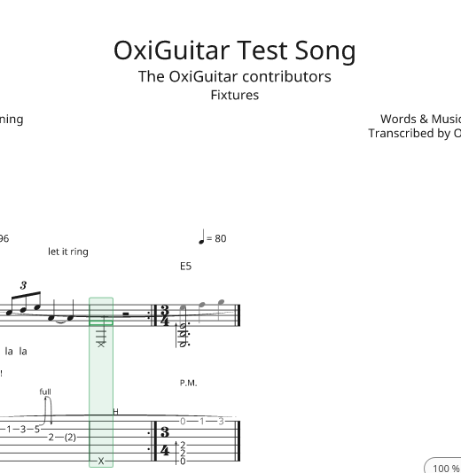
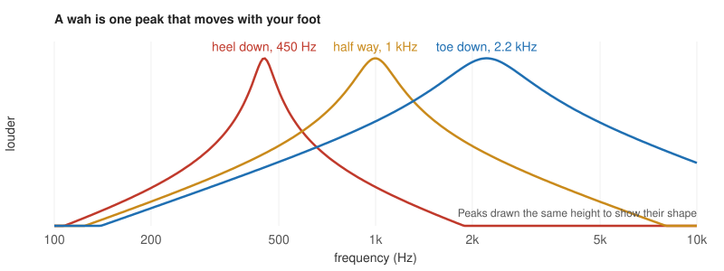

# Wah-wah plugin

This plugin brings the wah-wah pedal to OxiGuitar: it writes wah marks into a score, lets you shape how the pedal moves, and plays them. OxiGuitar itself has no wah tool, editor or sound. All of that comes from here.

You get two tools on the palette, under Effects, **Closed Wah-Wah** and **Open Wah-Wah**, and a small editor for each mark. When the song plays, the marks rock a virtual pedal back and forth. [How to use it](use-cases.md) walks through it.

## What a wah pedal does

A wah-wah is a guitar pedal you rock with your foot. Inside is a filter that boosts one narrow band of frequencies, a *resonance*, and lets the rest through quieter. Rocking the pedal slides that band up and down:

- **Heel down** (closed), the peak sits low, around 450 Hz, and is narrow: the sound is dark and throaty, like an "oo".
- **Toe down** (open), the peak moves up past 2 kHz and widens: the sound is bright and cutting, like an "ah".

Rock it in time and the guitar says "wah". Jimi Hendrix's "Voodoo Child (Slight Return)" and Isaac Hayes's "Theme from Shaft" made the sound famous, and the Dunlop Cry Baby is the pedal most people picture.

How sharp the peak is, is called its **Q**. A high Q is a narrow, nasal, vocal peak; a low Q is a gentle, wide one. The Cry Baby's is about 4 with the pedal half way.

## Wah marks in a score

Tablature writes the wah with two signs over a beat: **o** for open (toe down) and **+** for closed (heel down). They are part of the score: Guitar Pro files hold them, and OxiGuitar draws them with or without this plugin.

What a written mark can't say is *how* the pedal moves across the beat. This plugin adds that: each mark can carry its own curve, from heel to toe, and its own Q. Those are saved in the song's `.oxg` file beside it, since no score format has a place for them.
