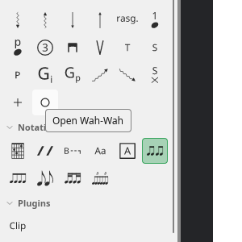
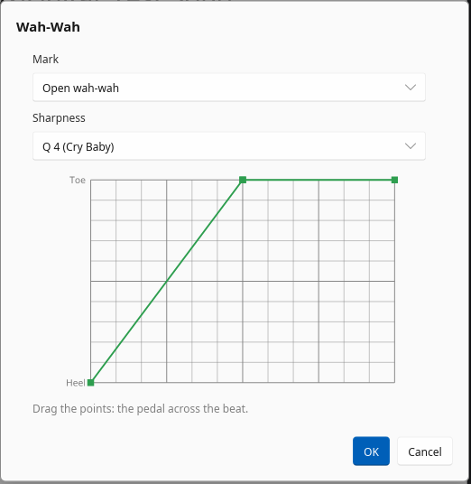
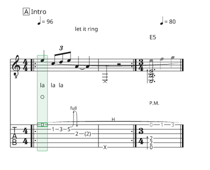
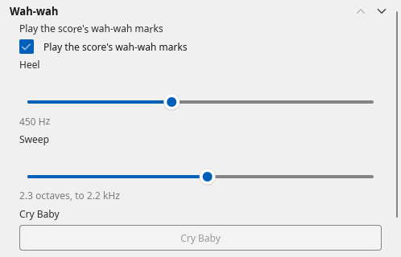

# How to use it

## Write a wah mark

1. Click the beat where the pedal should move, or select several beats.
2. In the palette on the left, under **Effects**, click **Open Wah-Wah** (the "o") or **Closed Wah-Wah** (the "+"):

3. The wah-wah editor opens:

   - **Mark** is none, open or closed.
   - **Sharpness** is the pedal's Q: 4 is a Cry Baby's, higher is more nasal and vocal, lower is gentler.
   - **The curve** is the pedal across the beat: left to right is time, bottom to top is heel to toe. Drag the points to shape it. An open mark starts with the pedal going from heel to toe over the first half of the beat.

4. Click **OK**. The mark appears over the beat, and one **Undo** takes it all back.

To change a mark later, select its beat and click either wah tool again.

## Hear it

Press Play. An open mark takes the pedal from heel to toe, a closed mark takes it back, and marks that alternate rock it back and forth. On beats with no mark the pedal is off. It works on any track, and sits before the amp and the equalizer, like a pedal in front of an amplifier.

## Tune the pedal for a track

On the **Track** tab, the **Wah-wah** section sets up the pedal for the track you are in:

- **Play the score's wah-wah marks**: untick it to keep this track's marks silent, for instance to hear a part dry.
- **Heel**: where the sweep starts, 200 to 800 Hz.
- **Sweep**: how far the toe takes it, 1 to 3.5 octaves.
- **Cry Baby** puts both back to a Cry Baby's (450 Hz, 2.3 octaves).

These work while the song plays.

## Good to know

- The open and closed marks are part of the score. Guitar Pro files keep them, and anyone opening the file sees them.
- Your curves and Q values are kept in the song's `.oxg` file beside it, since no score format has room for them. Share that file along with the song to keep them.
- They follow the beat when you copy or move it.
